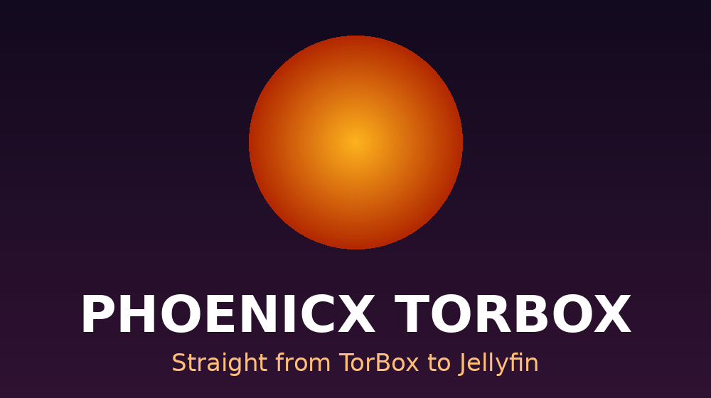

# Torvia — Jellyfin plugin

**Straight from TorBox to Jellyfin.**

Your **TorBox** movies and series as normal **Jellyfin** libraries, played **straight from TorBox** to your apps.

- Every finished movie and episode in your TorBox account (torrents, usenet, web downloads) shows up in Jellyfin with posters and details.
- Watched status, resume points and Continue Watching are kept on your Jellyfin server, per user.
- The video goes **TorBox → your app**. It does not pass through your server.
- Your TorBox API key stays on the server. Apps only get short-lived TorBox links.

Made by **Hanson** — [phoenicx.org](https://phoenicx.org)

## Install

1. Jellyfin Dashboard → **Plugins → Repositories → +**
   - Name: `Torvia`
   - URL: `https://raw.githubusercontent.com/hansonds/Torvia-Jellyfin/gh-pages/manifest.json`
2. **Catalog** → install **Torvia** → restart Jellyfin.
3. Dashboard → **Torvia**: paste your TorBox API key, **Save**, then **Sync now**.
4. Add the two folders shown on the plugin page as libraries (Dashboard → Libraries → Add Media Library):
   - **Movies** library → the Movies folder
   - **Shows** library → the Shows folder

### Subtitles

Subtitles inside the video (MKV) work as usual. Separate subtitle files in the TorBox download
(`.srt`, `.ass`, `.ssa`, `.vtt`, `.sub`, `.smi`) are downloaded and placed next to the movie or
episode, with the language when the file name has one (`Leo (2023).en.srt`, `Leo (2023).ta.srt`),
so they show in every app's subtitle menu.

### Tags → separate libraries

Tag your downloads on TorBox (edit a download → Tags), e.g. `movies`, `cinema`, `tv-shows`.
Each tag gets its own folder, `Tags/<tag>`, which you add as its own library. Downloads without a
tag go to the normal Movies / Shows folders. Keep movies and series in different tags, and pick
the library type (Movies or Shows) that matches. Turn this off on the plugin page if you don't want it.

The library syncs at startup and every 3 hours by default. Change it with **Sync interval** on the plugin page (30 minutes to once a day, or only at startup and with *Sync now*).

## How it works

The plugin writes a small `.strm` file for every movie and episode, e.g.
`Movies/Dune (2021)/Dune (2021).strm`. Inside is a signed link to your server:
`https://your-jellyfin-server/PhoenicxTorBox/Play/t/123/4?sig=…`

When an app asks to play the item, the plugin gets a fresh TorBox link and gives it to the app,
so the app streams from TorBox directly. Opening the `.strm` link itself redirects to TorBox too.

## Notes

- Apps must be able to play the file as it is (direct play). Without server transcoding a
  format the device can't play won't start.
- Some official apps may still stream through the server; Jellyfin web, Jellyfin Media Player and
  the Android app use the TorBox link directly.
- Badly named downloads can be fixed on the plugin page with **Name fixes**:
  `text in the TorBox name = Title (Year)`.
- Removing something from TorBox removes it from Jellyfin at the next sync.
